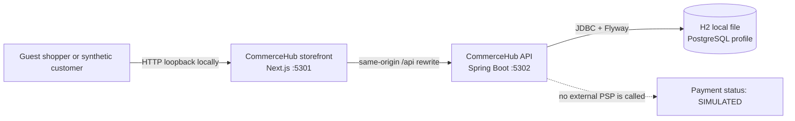
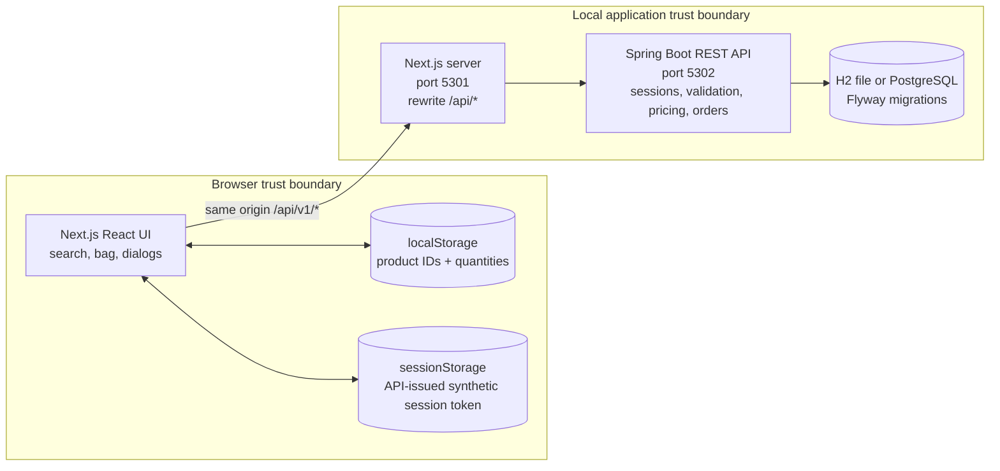
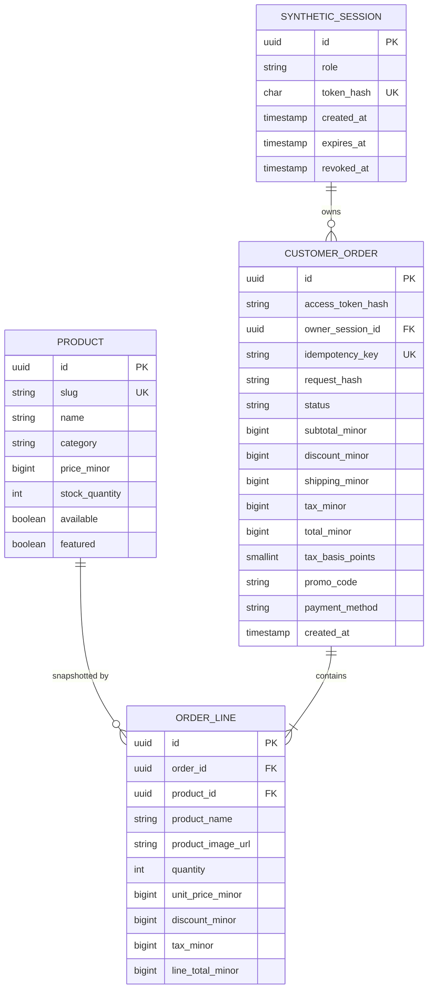

# CommerceHub Architecture

This document is the shared architecture source for the separate `commercehub-frontend` and `commercehub-backend` repositories. It describes the local APP-02 storefront as implemented on 2026-11-01. It is not a production-readiness or compliance certification.

The [data-mode guide](../../DATA_MODE_AND_ARCHITECTURE.md) documents endpoint
selection and the isolated mock/live E2E commands.

## Product and roles

CommerceHub is a fictional customer storefront. The local vertical slice supports browsing/search/filtering a seeded catalog, a browser-local bag, server-calculated quotes, the synthetic `HELLO10` promotion, simulated checkout, and receipt lookup. Both mock and live-selection modes obtain role choices and short-lived synthetic Customer, merchant, and support sessions from the selected API. The implemented order workflow is Customer-only. There are no external accounts, merchant/support order-management screens, wishlist, returns, real payment provider, shipment service, or live fulfillment.

## C4 Context



Trust boundaries: browser storage and browser inputs are untrusted; the Next.js server is a local proxy; Spring Boot owns role issuance, session validation, price, tax, shipping, promo validation, order state, and stock; the database persists synthetic records. The API does not contact an identity provider. Guest order-access keys and synthetic-session bearer tokens are local demo credentials, not production authentication.

## C4 Containers



## Data flow and ownership

1. The browser requests `GET /api/v1/products`; Next.js rewrites it to Spring Boot. Product values are synthetic seed data.
2. The browser sends product IDs, quantities, and an optional promo code to `POST /api/v1/orders/quote`. The API reloads current products and calculates all totals in integer minor units in both modes.
3. `isMock` selects the API origin only. In both modes, the browser loads `GET /api/v1/sessions/roles`, creates a synthetic role session, and keeps its short-lived API-issued bearer token in this tab's `sessionStorage`.
4. The API stores only a SHA-256 hash of each random 256-bit session token and returns the session ID, role, token, and expiry once. No name, address, email, password, or card data is requested or stored.
5. Checkout sends the same item request, a random idempotency key, and the API-issued bearer token. The API binds the order to the session ID. The backend retains its guest access-key endpoint for API compatibility, but the current storefront UI does not use it.
6. The API validates the request, checks promo and stock, locks product rows, recalculates the total, conditionally decrements stock, and inserts the order and item snapshots in one database transaction. A repeated key by the same owner returns the existing order; an owner mismatch is denied without returning another owner's receipt.
7. Order creation and receipt reads require the Customer role and matching owner session in the storefront. Merchant/support identities cannot use this customer order workflow.
8. Payment is stored only as `SIMULATED`; no payment network is called. Shipping and tax are illustrative configuration.

The localStorage bag contains only product IDs and quantities. It may be cleared by the user. Demo orders and inventory are local development data and are not personal data.

## Data model



Schema is versioned by Flyway. The local profile uses file-backed H2 in PostgreSQL compatibility mode because Docker/PostgreSQL are not installed on the current machine. A PostgreSQL profile and Compose file exist but have not been exercised here.

Guest orders keep `owner_session_id` null and store a hash of the order-access key. Authenticated orders store their owner session ID and leave `access_token_hash` null. The existing unique idempotency key remains unchanged; the service checks the owner before returning a replayed receipt.

## Implemented Design Patterns and Invariants

- **Modular monolith and layered API:** Spring Boot route/controller validation delegates to application/domain services and JDBC repositories; Flyway owns schema evolution. Next.js rewrites selected API traffic but does not calculate authoritative commerce state.
- **Server-authoritative quote and checkout:** the browser sends product identifiers, quantities, and an optional promo. The API reloads current catalog/stock, calculates integer-minor-unit totals, validates owner/session, and persists the order and item snapshots transactionally.
- **Synthetic identity boundary:** role choices and short-lived role sessions come from the selected API in both modes. API-issued tokens are tab-scoped; the frontend never invents role, ownership, or receipt authorization.
- **Idempotent order command:** a unique key and request hash prevent duplicate orders. A replay returns the prior receipt only to the same owner; conflicting payload/owner reuse is rejected.
- **Capability boundary:** order creation and lookup are customer-only; merchant/support role sessions do not imply permissions for unimplemented management workflows. Payment remains `SIMULATED`.

## Main workflow and failures

```mermaid
sequenceDiagram
  actor Shopper
  participant UI as Next.js storefront
  participant API as Spring Boot API
  participant DB as H2/PostgreSQL
  Shopper->>UI: Browse and add items
  UI->>API: GET /api/v1/products
  API-->>UI: Synthetic catalog
  UI->>API: POST /api/v1/orders/quote
  API->>DB: Read current price and stock
  API-->>UI: Server-calculated quote
  UI->>API: GET /api/v1/sessions/roles
  API-->>UI: Customer, merchant, support
  UI->>API: POST /api/v1/sessions
  API->>DB: Store role and token hash
  API-->>UI: Short-lived bearer token
  Shopper->>UI: Place demo order
  UI->>API: POST /api/v1/orders + idempotency key + bearer token
  API->>DB: Begin; verify owner; lock products; recalculate; decrement; insert order/lines
  DB-->>API: Commit
  API-->>UI: Synthetic CONFIRMED receipt
  UI-->>Shopper: Confirmation; no real charge
```

Expected recovery behavior: malformed request or unknown promo returns a safe 400 envelope; insufficient or changed stock returns 409 and preserves the bag; a repeated key with the same request returns the prior order; the same key with changed request returns 409; an expired or incorrect session cannot read an order; a missing/incorrect order access key returns 404 for the retained guest API compatibility path; an exhausted token bucket returns a safe 429 envelope. The UI displays server messages for quote errors and keeps checkout disabled until a current quote is available.

## API and logging

The versioned API contract is in [`openapi.yaml`](openapi.yaml). Every request receives validated `requestId` and `traceId` correlation values and response headers. JSON request-completion logs include route template, method, status, duration, outcome, and safe error code; query strings and request/response bodies are not logged. Session events include a hash of the session ID and the synthetic role, never the bearer token. Unknown URLs are logged as `/unmatched`, not with attacker-controlled path text. Order-created events contain a hash of the order ID, item count, total minor units, and `SIMULATED` status, not a raw order identifier or customer fields.

This correlation implementation is not an OpenTelemetry SDK or a PortfolioOps collector integration. No client analytics are sent.

## Security and privacy decisions

- Exact local CORS allowlist: `http://127.0.0.1:5301` and `http://localhost:5301`; no wildcard.
- Server-side runtime validation, parameterized JDBC queries, integer minor-unit money, transaction-scoped stock updates, and idempotency constraint.
- Loopback binding by default. Local sessions use a random 256-bit bearer token, store only its hash, expire after eight hours by default, and can be revoked. Authenticated order records bind to a session ID; only Customer sessions may create/read their own orders. The guest order-key API remains for compatibility but is not used by the current UI.
- No external identity provider, real customer identity fields, analytics, or external image requests. The browser stores the API-issued synthetic token in tab-scoped `sessionStorage`; do not treat these selectable synthetic roles as real authentication.
- Quote, checkout, receipt, and session operations use a per-process token bucket keyed by the direct socket peer (default burst 30, refill 30 per 60 seconds); catalog, role-list, preflight, and health routes are excluded. Forwarded-IP headers are not trusted. Requests through Next.js share its peer quota, the 4,096-entry LRU state resets on restart, and quotas are not coordinated across instances.
- Demo tax is illustrative; the default is 0 basis points. The built-in promo is synthetic.
- Next.js `robots.txt` disallows indexing; the privacy route describes actual local demo behavior and is not a production privacy policy.

## Local Verification and Coverage

Run the frontend from `commercehub-frontend` and the backend from
`commercehub-backend`:

```sh
npm run format:check
npm run test:identity
npm run test:unit
npm run test:e2e
NEXT_PUBLIC_IS_MOCK=false npm run test:e2e
npm run typecheck
npm run lint
COMMERCEHUB_MOCK_API_URL=http://127.0.0.1:5302 npm run build
npm audit --omit=dev

mvn -B verify
mvn -B -Pquality validate
sh scripts/check-java-lines.sh
```

The latest local frontend run passed 93 Jest tests with 99.55% statements,
97.68% branches, 98.96% functions, and 99.55% lines. Its global coverage gate
is 90%; `useSyntheticIdentity.ts`, `commerce-api.ts`, and `config.ts` each have
95% per-file gates. The 45-test Java run passed with 99.54% instructions,
98.81% branches, 100% methods, and 99.25% lines; JaCoCo also enforces 95% for
the order package, product catalog service, and synthetic session service.
`CommerceService` reached 98.76% instructions, 98.28% branches, 100% methods,
and 98.04% lines.

Playwright passed six browser workflows in each API mode using an isolated
in-memory H2 database. Those E2E runs prove selected-API routing and UI
workflows, not production PostgreSQL integration; they are not source-code
coverage. Individual noncritical frontend files such as `CommerceStore.tsx`
remain below 95% branches, while the aggregate application and critical backend
gates pass.

## Standards status and deviations

See [`quality-status.md`](quality-status.md) for executable checks, verified results, and remaining gaps. Local synthetic sessions and Customer owner/role checks cover the implemented order workflow only; there are no real customer accounts or merchant/support management features. PostgreSQL execution, fulfillment, return flows, distributed/app-wide rate limiting, PortfolioOps telemetry, full WCAG/axe, secret/SAST/Java dependency scanning, and production deployment controls remain incomplete. Do not expose this prototype or use real customer/order/payment data.
