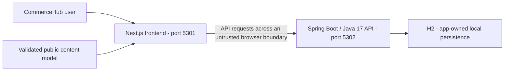
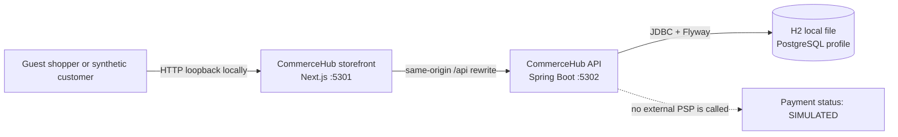
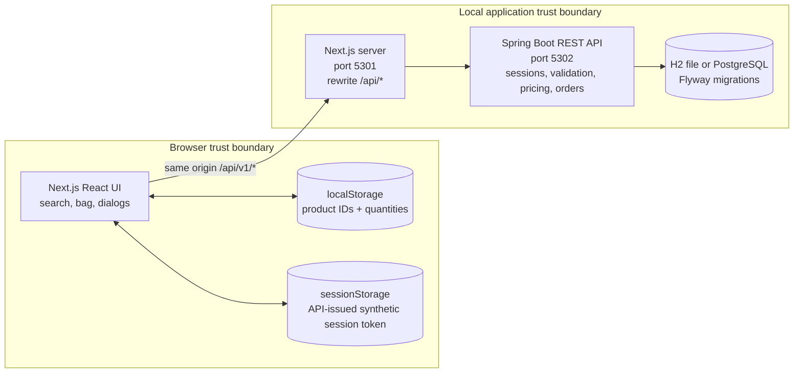
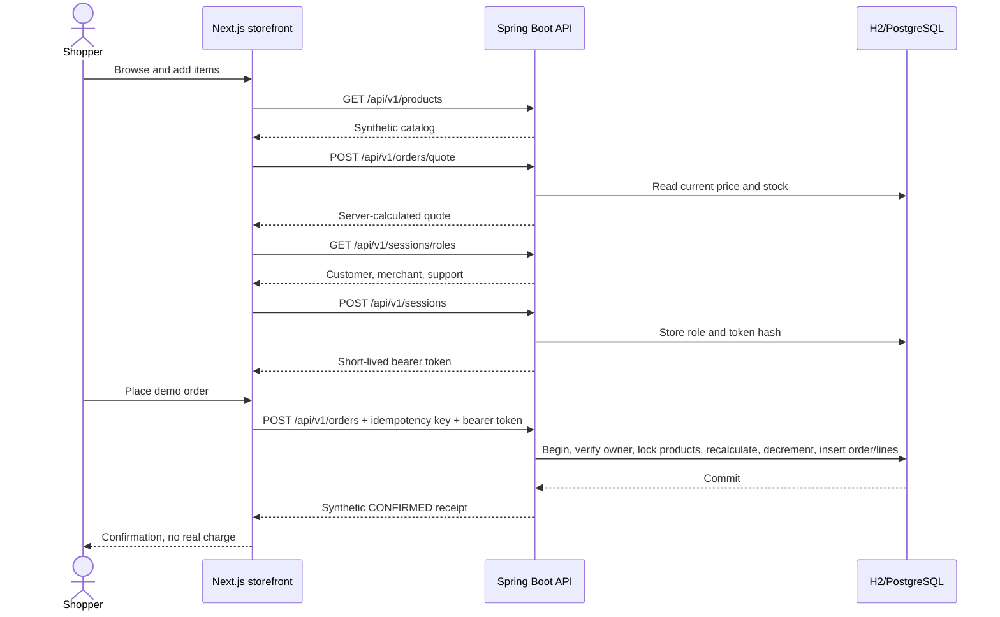
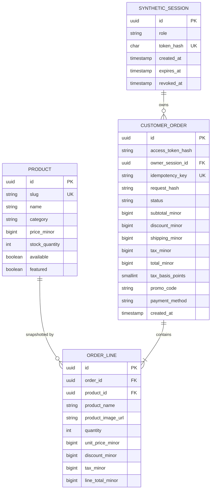
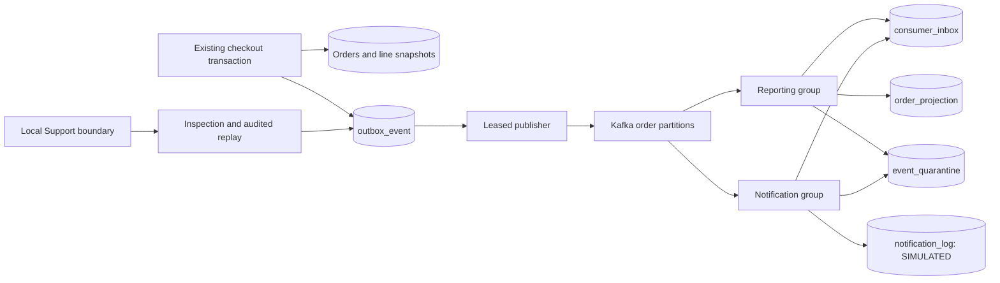
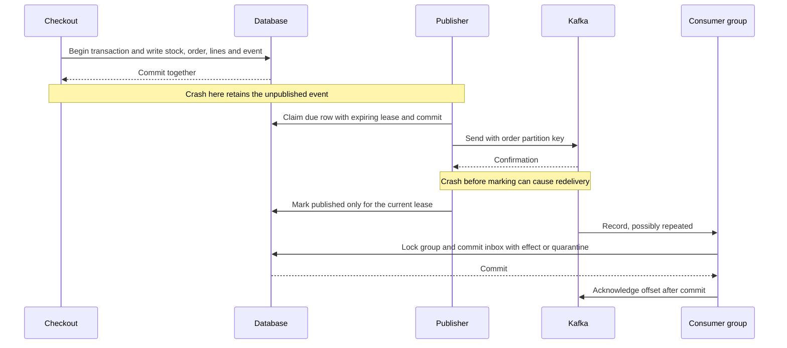

# CommerceHub Backend Architecture

Maintained in this independent Git repository at **docs/architecture.md**. Updated **2026-11-09**. The guide covers the implemented stack, interfaces, data model, operational limits, and release requirements.

## Contents

1. [Scope, users, and repository boundary](#1-scope-users-and-repository-boundary)
2. [Context, containers, and trust boundaries](#2-context-containers-and-trust-boundaries)
3. [Source ownership and module map](#3-source-ownership-and-module-map)
4. [Screens, navigation, and lifecycle](#4-screens-navigation-and-lifecycle)
5. [Primary workflows and recovery](#5-primary-workflows-and-recovery)
6. [Domain, persistence, and data ownership](#6-domain-persistence-and-data-ownership)
7. [API and internal contracts](#7-api-and-internal-contracts)
8. [Security, privacy, and egress](#8-security-privacy-and-egress)
9. [Design, accessibility, and platform adapters](#9-design-accessibility-and-platform-adapters)
10. [Build, checks, and deployment](#10-build-checks-and-deployment)
11. [Architecture decisions and tradeoffs](#11-architecture-decisions-and-tradeoffs)
12. [Requirements traceability](#12-requirements-traceability)
13. [Dated verification and limitations](#13-dated-verification-and-limitations)
14. [Extension rules and companion repository](#14-extension-rules-and-companion-repository)

## 1. Scope, users, and repository boundary

A synthetic storefront for customers, with merchant and support profiles.

Catalog search, category filters, sorting, local cart, server quotes, simulated checkout, and session-scoped order lookup.

This repository owns the Spring Boot / Java 17 API and H2 state. UI rendering belongs to the separate frontend. The service validates and executes the domain operations described below.

There are two independent Git roots for this application, each with its own README and architecture guide. A parent app/workspace folder is a checkout convenience. Use synthetic records; current local services remain on loopback.

### Product and roles

CommerceHub is a fictional customer storefront. The local vertical slice supports browsing/search/filtering a seeded catalog, a browser-local bag, server-calculated quotes, the synthetic `HELLO10` promotion, simulated checkout, and receipt lookup. Both mock and live-selection modes obtain role choices and short-lived synthetic Customer, merchant, and support sessions from the selected API. The implemented order workflow is Customer-only. There are no external accounts, merchant/support order-management screens, wishlist, returns, real payment provider, shipment service, or live fulfillment.

## 2. Context, containers, and trust boundaries



The API is the data authority, but only the identity/ownership controls actually implemented below can be relied on. CORS is not authentication.

### C4 Context



Trust boundaries: browser storage and browser inputs are untrusted; the Next.js server is a local proxy; Spring Boot owns role issuance, session validation, price, tax, shipping, promo validation, order state, and stock; the database persists synthetic records. The API does not contact an identity provider. Guest order-access keys and synthetic-session bearer tokens are local demo credentials, not production authentication.

### C4 Containers



## 3. Source ownership and module map

| Owner/path                                                                                                                                                                                                                                                                                                                                                                                                                                        | Responsibility                                                               |
| ------------------------------------------------------------------------------------------------------------------------------------------------------------------------------------------------------------------------------------------------------------------------------------------------------------------------------------------------------------------------------------------------------------------------------------------------- | ---------------------------------------------------------------------------- |
| [src/main/java/com/commercehub/CommerceHubApplication.java](../src/main/java/com/commercehub/CommerceHubApplication.java)                                                                                                                                                                                                                                                                                                                         | Spring Boot process entry                                                    |
| [src/main/java/com/commercehub/catalog/ProductController.java](../src/main/java/com/commercehub/catalog/ProductController.java)<br>[src/main/java/com/commercehub/health/HealthController.java](../src/main/java/com/commercehub/health/HealthController.java)<br>[src/main/java/com/commercehub/order/OrderController.java](../src/main/java/com/commercehub/order/OrderController.java)                                                         | HTTP adapters and public request handling                                    |
| [src/main/java/com/commercehub/catalog/ProductCatalogService.java](../src/main/java/com/commercehub/catalog/ProductCatalogService.java)<br>[src/main/java/com/commercehub/order/CommerceService.java](../src/main/java/com/commercehub/order/CommerceService.java)                                                                                                                                                                                | Application/domain services; verify individual transaction/permission owners |
| [src/main/java/com/commercehub/order/OrderRepository.java](../src/main/java/com/commercehub/order/OrderRepository.java)<br>[src/main/java/com/commercehub/security/SyntheticSessionRepository.java](../src/main/java/com/commercehub/security/SyntheticSessionRepository.java)                                                                                                                                                                    | Persistence boundary and queries                                             |
| [src/main/java/com/commercehub/security/SyntheticSessionController.java](../src/main/java/com/commercehub/security/SyntheticSessionController.java)<br>[src/main/java/com/commercehub/security/SyntheticSessionService.java](../src/main/java/com/commercehub/security/SyntheticSessionService.java)                                                                                                                                              | Security/session configuration and synthetic identity                        |
| [src/main/java/com/commercehub/api/ApiExceptionHandler.java](../src/main/java/com/commercehub/api/ApiExceptionHandler.java)<br>[src/main/java/com/commercehub/config/RequestIdFilter.java](../src/main/java/com/commercehub/config/RequestIdFilter.java)                                                                                                                                                                                          | Safe error handling and request logging                                      |
| [src/main/resources/db/migration/V1__commercehub_schema.sql](../src/main/resources/db/migration/V1__commercehub_schema.sql)<br>[src/main/resources/db/migration/V2__correct_demo_daypack_catalog_item.sql](../src/main/resources/db/migration/V2__correct_demo_daypack_catalog_item.sql)<br>[src/main/resources/db/migration/V3__add_synthetic_session_ownership.sql](../src/main/resources/db/migration/V3__add_synthetic_session_ownership.sql) | Ordered Flyway schema/seed migrations                                        |
| [src/main/resources/application-postgres.yml](../src/main/resources/application-postgres.yml)<br>[src/main/resources/application.yml](../src/main/resources/application.yml)                                                                                                                                                                                                                                                                      | Local/postgres profile configuration                                         |
| [pom.xml](../pom.xml)                                                                                                                                                                                                                                                                                                                                                                                                                             | Java/dependency/build/quality gate authority                                 |
| [docs/openapi.yaml](../docs/openapi.yaml)                                                                                                                                                                                                                                                                                                                                                                                                         | Published request/response contract source                                   |
| [src/test](../src/test)                                                                                                                                                                                                                                                                                                                                                                                                                           | Existing test/support directory; configured does not mean rerun              |
| [.github/workflows](../.github/workflows)                                                                                                                                                                                                                                                                                                                                                                                                         | Configured CI; hosted outcomes require separate verification                 |

The source map follows the existing framework directories and test placement.

## 4. Screens, navigation, and lifecycle

This repository has no rendered screens. It supports the frontend through the HTTP/domain contracts in sections 5–7. Its lifecycle entry, response/error mapping, session behavior where present, and storage ownership are listed in section 3. Startup health is http://127.0.0.1:5302/health; that configured address is not evidence of a running service. Persistent state is owned by this backend; preserve existing database files during changes.

## 5. Primary workflows and recovery

### Main workflow and failures



Expected recovery behavior: malformed request or unknown promo returns a safe 400 envelope; insufficient or changed stock returns 409 and preserves the bag; a repeated key with the same request returns the prior order; the same key with changed request returns 409; an expired or incorrect session cannot read an order; a missing/incorrect order access key returns 404 for the retained guest API compatibility path; an exhausted token bucket returns a safe 429 envelope. The UI displays server messages for quote errors and keeps checkout disabled until a current quote is available.

## 6. Domain, persistence, and data ownership

The API owns the current persistence boundary. Keep database engines, schema/migration order, exact-money rules where applicable, and transaction invariants consistent with executable source.

### Data flow and ownership

1. The browser requests `GET /api/v1/products`; Next.js rewrites it to Spring Boot. Product values are synthetic seed data.
2. The browser sends product IDs, quantities, and an optional promo code to `POST /api/v1/orders/quote`. The API reloads current products and calculates all totals in integer minor units in both modes.
3. `isMock` selects the API origin only. In both modes, the browser loads `GET /api/v1/sessions/roles`, creates a synthetic role session, and keeps its short-lived API-issued bearer token in this tab's `sessionStorage`.
4. The API stores only a SHA-256 hash of each random 256-bit session token and returns the session ID, role, token, and expiry once. No name, address, email, password, or card data is requested or stored.
5. Checkout sends the same item request, a random idempotency key, and the API-issued bearer token. The API binds the order to the session ID. The backend retains its guest access-key endpoint for API compatibility, but the current storefront UI does not use it.
6. The API validates the request, checks promo and stock, locks product rows, recalculates the total, conditionally decrements stock, and inserts the order and item snapshots in one database transaction. A repeated key by the same owner returns the existing order; an owner mismatch is denied without returning another owner's receipt.
7. Order creation and receipt reads require the Customer role and matching owner session in the storefront. Merchant/support identities cannot use this customer order workflow.
8. Payment is stored only as `SIMULATED`; no payment network is called. Shipping and tax are illustrative configuration.

The localStorage bag contains only product IDs and quantities. It may be cleared by the user. Demo orders and inventory are local development data and are not personal data.

### Data model



Schema is versioned by Flyway. The local profile uses file-backed H2 in PostgreSQL compatibility mode because Docker/PostgreSQL are not installed on the current machine. A PostgreSQL profile and Compose file exist but have not been exercised here.

Guest orders keep `owner_session_id` null and store a hash of the order-access key. Authenticated orders store their owner session ID and leave `access_token_hash` null. The existing unique idempotency key remains unchanged; the service checks the owner before returning a replayed receipt.

## 7. API and internal contracts

The repository contract is [docs/openapi.yaml](../docs/openapi.yaml). Keep public paths, status/error envelopes, headers, payload validation, and compatibility tied to that source.

### API and logging

The versioned API contract is in [`openapi.yaml`](openapi.yaml). Every request receives validated `requestId` and `traceId` correlation values and response headers. JSON request-completion logs include route template, method, status, duration, outcome, and safe error code; query strings and request/response bodies are not logged. Session events include a hash of the session ID and the synthetic role, never the bearer token. Unknown URLs are logged as `/unmatched`, not with attacker-controlled path text. Order-created events contain a hash of the order ID, item count, total minor units, and `SIMULATED` status, not a raw order identifier or customer fields.

This correlation implementation is not an OpenTelemetry SDK or a PortfolioOps collector integration. No client analytics are sent.

## 8. Security, privacy, and egress

Current release limitation: **The published baseline uses synthetic sessions. Verified-authentication/PostgreSQL candidate work exists separately in IT and is not included in these repositories. Formatting, development dependency, and deployment gaps remain.**

### Security and privacy decisions

- Exact local CORS allowlist: `http://127.0.0.1:5301` and `http://localhost:5301`; no wildcard.
- Server-side runtime validation, parameterized JDBC queries, integer minor-unit money, transaction-scoped stock updates, and idempotency constraint.
- Loopback binding by default. Local sessions use a random 256-bit bearer token, store only its hash, expire after eight hours by default, and can be revoked. Authenticated order records bind to a session ID; only Customer sessions may create/read their own orders. The guest order-key API remains for compatibility but is not used by the current UI.
- No external identity provider, real customer identity fields, analytics, or external image requests. The browser stores the API-issued synthetic token in tab-scoped `sessionStorage`; do not treat these selectable synthetic roles as real authentication.
- Quote, checkout, receipt, and session operations use a per-process token bucket keyed by the direct socket peer (default burst 30, refill 30 per 60 seconds); catalog, role-list, preflight, and health routes are excluded. Forwarded-IP headers are not trusted. Requests through Next.js share its peer quota, the 4,096-entry LRU state resets on restart, and quotas are not coordinated across instances.
- Demo tax is illustrative; the default is 0 basis points. The built-in promo is synthetic.
- Next.js `robots.txt` disallows indexing; the privacy route describes actual local demo behavior and is not a production privacy policy.

Keep private credentials out of public models, browser bundles, logs, URLs, and source archives. No additional runtime network destination or external service is configured. Keep logs limited to the source-defined request/trace and safe aggregate fields. Backups, retention, deletion, and real-user ownership need explicit product/operations decisions before external exposure.

## 9. Design, accessibility, and platform adapters

There is no visual rendering or native package in this API repository. Preserve safe errors and stable contracts so the frontend can present accessible recovery states. Hardware scanning, banking/payment rails, shipping providers, and native integrations remain limited to what the current source actually implements; simulator behavior is not device/provider integration.

## 10. Build, checks, and deployment

Use Java **17** and Maven **3.9.16** with [pom.xml](../pom.xml). `mvn.cmd -B -ntp -Dspring.profiles.active=test verify` uses the configured isolated test profile. Run local startup through the existing README command; inherited DEBUG must be removed only in newly launched Java processes. Java verification was not rerun for the documentation updates. Maven dependency installation needs registry access.

The API remains loopback-only. Direct-start storage is `.local/commercehub` relative to this repository.

CI configuration is listed in section 3. Run the configured checks before merging or releasing. Deployment requires separate verification of the selected hosting environment.

## 11. Architecture decisions and tradeoffs

### Implemented Design Patterns and Invariants

- **Modular monolith and layered API:** Spring Boot route/controller validation delegates to application/domain services and JDBC repositories; Flyway owns schema evolution. Next.js rewrites selected API traffic but does not calculate authoritative commerce state.
- **Server-authoritative quote and checkout:** the browser sends product identifiers, quantities, and an optional promo. The API reloads current catalog/stock, calculates integer-minor-unit totals, validates owner/session, and persists the order and item snapshots transactionally.
- **Synthetic identity boundary:** role choices and short-lived role sessions come from the selected API in both modes. API-issued tokens are tab-scoped; the frontend never invents role, ownership, or receipt authorization.
- **Idempotent order command:** a unique key and request hash prevent duplicate orders. A replay returns the prior receipt only to the same owner; conflicting payload/owner reuse is rejected.
- **Capability boundary:** order creation and lookup are customer-only; merchant/support role sessions do not imply permissions for unimplemented management workflows. Payment remains `SIMULATED`.

The two Git repositories remain separate. Each owns one maintained README and this repository-local architecture guide. Shared application behavior may be described here for contract context, but implementation changes belong to the owning source module.

## 12. Requirements traceability

| Capability                       | Acceptance                                                        | Owner/path                                                             | Current status                                                | Evidence                               | Risk                                                                                                                                                                                                                                 |
| -------------------------------- | ----------------------------------------------------------------- | ---------------------------------------------------------------------- | ------------------------------------------------------------- | -------------------------------------- | ------------------------------------------------------------------------------------------------------------------------------------------------------------------------------------------------------------------------------------ |
| Repository-local architecture    | Guide available in this checkout and linked from README           | docs/architecture.md; README.md                                        | Documented and validated                                      | File, link, and diagram checks         | Keep documentation consistent with source changes                                                                                                                                                                                    |
| API composition and domain state | Preserve existing workflows and failure states                    | src/main/java/com/commercehub/api/ApiErrorResponse.java and source map | Implemented; application verification limits are listed below | Current source and existing app design | The published baseline uses synthetic sessions. Verified-authentication/PostgreSQL candidate work exists separately in IT and is not included in these repositories. Formatting, development dependency, and deployment gaps remain. |
| Public deployment                | Verified identity, data durability, recovery, and hosted behavior | Existing deployment/API boundaries                                     | Needs separate hardening/verification                         | No new hosted evidence                 | Local checks do not establish production readiness                                                                                                                                                                                   |

## 13. Dated verification and limitations

Last documentation review: **2026-11-09**. The checks below distinguish documentation validation from application and deployment testing.

- Repository-local guide, README link, source-path references, section/contents anchors, and Mermaid syntax: passed documentation validation.
- New application tests/builds, coverage, dependency audits, browser/device accessibility/performance, hosted CI, and Vercel deployment: **not rerun for the documentation updates**.
- Frontend production builds passed on 2026-11-09 with Node 24.15.0. Build success does not establish that all application quality gates pass.
- Outstanding baseline limit: The published baseline uses synthetic sessions. Verified-authentication/PostgreSQL candidate work exists separately in IT and is not included in these repositories. Formatting, development dependency, and deployment gaps remain.

The baseline results below record earlier validation. Re-run the listed commands against the current revision before release.

Previously recorded application verification:

### Local Verification and Coverage

Run the frontend from `commercehub-frontend` and the backend from
`commercehub-backend`:

```sh
npm run format:check
npm run test:identity
npm run test:unit
npm run test:e2e
NEXT_PUBLIC_IS_MOCK=false npm run test:e2e
npm run typecheck
npm run lint
COMMERCEHUB_MOCK_API_URL=http://127.0.0.1:5302 npm run build
npm audit --omit=dev

mvn -B verify
mvn -B -Pquality validate
sh scripts/check-java-lines.sh
```

The latest local frontend run passed 93 Jest tests with 99.55% statements,
97.68% branches, 98.96% functions, and 99.55% lines. Its global coverage gate
is 90%; `useSyntheticIdentity.ts`, `commerce-api.ts`, and `config.ts` each have
95% per-file gates. The 45-test Java run passed with 99.54% instructions,
98.81% branches, 100% methods, and 99.25% lines; JaCoCo also enforces 95% for
the order package, product catalog service, and synthetic session service.
`CommerceService` reached 98.76% instructions, 98.28% branches, 100% methods,
and 98.04% lines.

Playwright passed six browser workflows in each API mode using an isolated
in-memory H2 database. Those E2E runs prove selected-API routing and UI
workflows, not production PostgreSQL integration; they are not source-code
coverage. Individual noncritical frontend files such as `CommerceStore.tsx`
remain below 95% branches, while the aggregate application and critical backend
gates pass.

### Standards status and deviations

See [`quality-status.md`](quality-status.md) for executable checks, verified results, and remaining gaps. Local synthetic sessions and Customer owner/role checks cover the implemented order workflow only; there are no real customer accounts or merchant/support management features. PostgreSQL execution, fulfillment, return flows, distributed/app-wide rate limiting, PortfolioOps telemetry, full WCAG/axe, secret/SAST/Java dependency scanning, and production deployment controls remain incomplete. Do not expose this prototype or use real customer/order/payment data.

## 14. Extension rules and companion repository

### BE-02 decisions and acceptance plan — November 18, 2026

BE-02 is an owner-requested feature on local branch `feature/be02-order-events`, based on `7d65634`.
The separate IT candidate has newer Supabase/auth/recovery work; it is deliberately excluded. Merging
those lines requires reviewed forward migrations (both lines use V4), not copying migration files.
No hosted database or other app is part of this feature. The original handoff remains historical.

1. **Kafka versus RabbitMQ.** Independent reporting and simulated notification groups replay an ordered
   event log. Kafka partitions/offsets fit this purpose. RabbitMQ's work-distribution/acknowledgement model
   fits DispatchForge jobs. DispatchForge's architecture file was absent at inspection; no claim about
   its implemented broker behavior is inferred. This is an explicitly requested service, not a roadmap retrofit.
2. **Outbox versus dual write/CDC.** Order, stock, lines and one `ORDER_PLACED` event commit in the same
   existing JDBC transaction. A direct DB+broker dual write can lose one half. CDC would add operational
   services; polling with a leased claim is sufficient here. No historical orders are backfilled implicitly.
3. **One application.** Separate event writer, publisher, consumer and admin modules; two Kafka groups,
   one database. No microservices or cross-app integration. Events default off; no Kafka connection then.
4. **Contract.** Topic `commerce.order-placed.v1`, key canonical order UUID, schema/version 1, authoritative
   status `CONFIRMED`. Payload allows order ID, exact USD total and line count only. No identities,
   tokens, keys, addresses, item text or payment instruments. Unknown fields/schema and key mismatch quarantine.
5. **Delivery.** Bounded leased claims use `FOR UPDATE SKIP LOCKED` on both tested engines. Network I/O
   occurs outside the claim transaction. Confirmed broker sends alone mark published; lost confirmations
   can duplicate delivery. Ten attempts, bounded exponential backoff/jitter; exhausted rows await audited retry.
6. **Effects.** Each group commits its inbox plus effect in one database transaction, then acknowledges
   its Kafka record. A per-order version lock protects reporting changes. Duplicate IDs have no second effect;
   stale/gapped versions and poison are quarantined with durable reason/hash/location. Retrying a quarantine
   uses the trusted original outbox payload; arbitrary replacement JSON is never accepted.
7. **Local operations.** SUPPORT is the synthetic local operator; CUSTOMER/MERCHANT/anonymous denied.
   This is selectable demo identity, not production administration. Require loopback peer and Host, exact
   configured Origin on replay, bounded pages/requests, replay key, rate limit, durable audit. No public admin.
8. **Runtime proof.** Spring Boot 3.5.6 BOM manages Spring Kafka 3.3.10/Kafka 3.9.1 (read from local BOM).
   Use embedded real KRaft and Zonky PostgreSQL 17.11 tests without Docker. PostgreSQL state is isolated;
   no shared/hosted credentials. Windows broker file-lock limitations remain documented.
9. **Authentication standard.** Validate all server boundaries with allowlisted fields/bounds; parameterize
   SQL and contextually encode output. Do not mutate passwords by generic "cleaning". Trusted Supabase
   owns password hashing in the separate IT line. Generic login/reset results, bounded temporary throttling
   and provider abuse controls replace permanent attacker-triggerable account locks. This baseline still
   has synthetic roles, no passwords, and cannot truthfully claim real account lockouts or secure accounts.

M0: unchanged `mvn -B -ntp -Pquality -Dspring.profiles.active=test verify` passed (fresh counts below).
M1: atomic outbox and rollback on H2/PostgreSQL. M2: confirms/retries/leases. M3: inbox/effects/quarantine.
M4: local operator inspection, truthful freshness/lag and replay. M5: real failure/soak/performance proof,
mutation/secret/dependency checks, guide and learning notes. Remain IN_PROGRESS until all required evidence exists.





`V4` adds outbox, inbox, projection, simulated notification log, group serialization/status,
safe quarantine and replay audit. Rows contain no customer identity or payment instrument. Event ID
uniqueness scopes inboxes to consumer name; each order/version has one outbox row. Published replay
may send the same row again; the invariant concerns one source row/effect, not one network transmission.
No polling lock is held during Kafka I/O. `FOR UPDATE SKIP LOCKED` and the portable insert/update
statements are tested on H2 PostgreSQL mode and PostgreSQL 17.11. See the source migration for constraints/indexes.

Inspection uses bounded offset pages (at most page 1000, size 100), acceptable for this small local
operator view; larger operated histories need keyset pagination/retention. Consumers deliberately
serialize on one status row per group. These choices trade scale for clear, tested local semantics.

Primary references reviewed 2026-11-18: Spring Kafka 3.3 testing/reference, Apache Kafka 3.9 producer
configuration, Spring Boot 3.5.6 local dependency BOM. Moving latest docs describe newer releases;
the actual resolved BOM, not those pages' current version, determines this implementation.

### BE-02 dated evidence and release boundary

Local branch remains uncommitted from `7d65634bd800d339c5bed3623ec801eab7534eb6`; `main` is unchanged.
The frontend repository remains clean. No hosted Supabase, original `.local` database, IT sources,
other project, credentials, public service, billing or GitHub publication was changed by BE-02.
The archive verifier is not a feature acceptance tool: this deliberately changes baseline source on a
feature branch, while archived handoffs and their original snapshot claims remain historical.

Environment: Windows 11, Ryzen 7 7840HS, 16 logical processors, approximately 31 GiB RAM;
Node 24.15.0, Java 17.0.19, Maven 3.9.16, H2 2.3.232, PostgreSQL 17.11, Spring Kafka 3.3.10/Kafka 3.9.1.
Java instruction/branch/method/line counters are not JavaScript statement/function counters.
Five-dependency orchestration constructors in CommerceService/PipelineController are a deliberate
composition exception to the four-parameter target; no public HTTP/domain command acquires five arguments.
No Sonar complexity/duplication, full security certification, frontend accessibility or field Web Vitals is claimed.

| Check / exact command from backend | Result and evidence | Limits |
| --- | --- | --- |
| `mvn -B -ntp -Pquality -Dspring.profiles.active=test verify` before changes | PASS: 46 tests; `target/be02-baseline.log`; 90/95 gates passed | Original baseline, not today's complete feature |
| `mvn -B -ntp -Dtest=OutboxWorkflowTest test` before implementation | Expected FAIL: outbox table absent, `target/be02-red-outbox.log` | Positive regression control |
| `mvn -B -ntp -Dtest=OutboxWorkflowTest,PostgresPipelineTest test` | PASS: first 22 real-engine checks, `target/be02-engine.log` | H2 and native PostgreSQL, no hosted DB |
| Full verify before final QA fix | PASS: 79 tests, no skips; instructions 99.68%, branches 99.01%, methods 100%, lines 99.51%; `target/be02-final.log` | Later Origin fix and concurrency tests require fresh rerun |
| User scenarios | 19 automated rows, IDs in tests, scenario-check positive control | Human demo/teach-backs are separate |
| Actual process recovery | PASS: commit-before-publish crash, duplicate, broker outage, real poison/quarantine/replay, 3 seeded crashes, 49 orders with stock/effects consistent; zero final lag/backlog | Short bounded rehearsal; unique directories under `target/be02-process/` contain results.json |
| `scripts/Run-EventLab.ps1` then `node scripts/probe-event-lab.mjs` | PASS: compiled lab startup/Enter shutdown and 30 real HTTP checks; `target/be02-live-qa.json` | No browser UI added; baseline storefront QA remains separate |
| `node scripts/check-guards.mjs` and corrected `... broker-confirmation` | PASS: 5/5 behavioral guard mutations caught, exact source-byte restoration; `target/be02-mutations/` | Initial confirmation mutant compilation failure was not counted |
| `mvn dependency:list -DincludeScope=test -DoutputFile=target/be02-dependencies.txt`; `node scripts/make-dependency-sbom.mjs`; OSV 2.7.1 `scan source --sbom target/be02-bom.cdx.json` | FAIL release gate: 94 package/advisory pairs across 25 versions in 146 resolved package versions, `target/be02-osv-resolved.json` | Direct POM-only scan was incomplete and superseded; scanner findings require affectedness/patch review |
| Gitleaks 8.30.1 `git --redact=100` and `dir --redact=100` over source-only selection | PASS: 2 existing commits and current source, no findings; synthetic github-pat positive control detected | Generated data/private profiles excluded; no raw values in report |
| YAML and Mermaid parse | PASS: workflow/OpenAPI YAML and 8 diagrams (Mermaid with DOM shim); PowerShell parser passed | CI never pushed/run; syntax parsing is not execution or a screenshot |
| `node scripts/verify-under-load.mjs` first attempt | FAIL: retained empty DEBUG enabled framework debug output, existing log privacy scenario caught synthetic path text | Runner corrected to delete DEBUG from child env; failure preserved in `target/be02-under-load-inherited-debug.log` |
| Corrected CPU-contention / 12-cycle run | IN PROGRESS at this entry; final result appended below | Four local CPU workers; not an idle-machine benchmark |

First real process run measured 12 sequential orders after 3 warm-ups, 3 repetitions, fixed poll 500ms/batch 25:
p50 192.8–225.8ms; p95 482.5–504.8ms. A subsequent pre-final run measured p50 176.4–203.7ms,
p95 480.3–490.5ms, and 15,601ms catch-up including broker restart for 5 queued orders. These are not
an idle-machine, independently tuned hold-out workload or production capacity claim. The final harness
also runs 20 orders on 4 clients without retuning, and can select 3–30 seeded crash cycles.
The latency clock is the database event/order timestamp to the application's confirmed-publication mark.
PostgreSQL CURRENT_TIMESTAMP is the transaction start time, so these samples include checkout transaction
time; they are not an instrumented exact commit-to-broker-ACK measurement. This is an explicit remaining
part of experiment 6, along with idle-machine tuning. No tighter timing claim follows from the reported numbers.

### Release closeout against program section 6

| Requirement | Status | Evidence / outstanding work |
| --- | --- | --- |
| Agreed scope/M0–M5 | FAIL | M0–M4 built; M5 dependency/tuning/hosted evidence still open |
| Build/run | PASS | Real H2/default compatibility, PostgreSQL/Kafka lab, compiled artifact and helper |
| Scenario tests | PASS for recorded runs | 19 scenarios, engine/API/process layers; final rerun tracked separately |
| Coverage | PASS for recorded full run | 90% overall and 95% per critical event/domain class, no exclusions/gate reduction |
| Security/privacy | FAIL release gate | Local authorization/redaction/quotas tested; known unsuppressed dependency findings |
| CV evaluation | N/A | Backend only |
| Queue/transaction proof | PASS for bounded local rehearsal | Same transaction, rollback, confirm/retry, inbox, poison/replay, process failures |
| UI/accessibility | N/A for this feature | No frontend changes/page; existing customer-browser issues not resolved here |
| Performance | FAIL full acceptance | Local repeated samples exist; independent idle-machine tuning proof is unmeasured |
| Documentation | PASS for local feature | README, architecture, OpenAPI, threat model, scenarios, guide, learning |
| Developer learning | BLOCKED on human review | All teach-backs PENDING; no mastery claimed |
| Repo integrity | PASS local | Feature branch only, main unchanged, no unrelated code/IT changes, scans and reviewed diff |
| Closeout report | PASS local record | This table, scenario QA defects and source evidence |
| Human sign-off | BLOCKED | Not given; later projects stay LOCKED |

### Spec acceptance and experiments

| Spec item | Status | Evidence / limits |
| --- | --- | --- |
| Existing API/idempotency/stock preserved | PASS | Existing tests plus live checkout/replay; feature defaults off |
| Atomic outbox on PostgreSQL | PASS | OUT-01 and OUT-02 run on real PostgreSQL and H2 |
| Rollback leaves neither order nor event | PASS | Outer transaction failure restores stock and row counts |
| Duplicates/reordered records have no repeated effects | PASS | CON-01/02, ORD-01, real Kafka duplicate, per-group inbox/commit |
| Broker outage/backlog/recovery | PASS local | Five queued orders survive restart; final projection/inbox/stock consistent |
| Retry bounds/poison/observability/no secrets | PASS local controls | PUB, POI, ADM, OBS, SEC scenarios; dependency findings still block release |
| Versioned contracts/migrations/recovery docs | PASS | V4 additive only; topic/schema v1; no implicit backfill |
| No unsupported readiness/microservice claim | PASS | Local modular app and explicit limits |
| Experiment 1: Kafka/RabbitMQ concepts | PASS notes / human PENDING | Learning guide; no change to DispatchForge |
| Experiment 2: crash after commit | PASS | Workers-off commit, kill owned app, restart workers, recover |
| Experiment 3: duplicate event | PASS | Real record resent; duplicate counters increase, effects do not |
| Experiment 4: stop broker and catch up | PASS | Actual owned Kafka process kill/restart and retained DB backlog |
| Experiment 5: versions/poison/replay | PASS | Engine gap/stale tests, real unknown-schema quarantine and authorized trusted replay |
| Experiment 6: latency/tuning/lag | FAIL full acceptance | Repeated local p50/p95 and final offsets measured; idle/tuned independent workload not yet established |
| Random-crash soak | IN PROGRESS at this entry | Extended 12-cycle run executing; initial 3-cycle rehearsal passed |
| Hosted CI/container services | NOT RUN | SHA-pinned actions and local-only service-engine profile prepared; no push allowed |
| Narrated 60–120 second demo | NOT PRODUCED | Owner artifact, not simulated by an agent |

### Sources and tooling provenance

- [Spring Kafka 3.3 testing](https://docs.spring.io/spring-kafka/reference/3.3/testing.html),
  [Kafka 3.9 producer configuration](https://kafka.apache.org/39/configuration/producer-configs/),
  [Zonky embedded PostgreSQL](https://github.com/zonkyio/embedded-postgres): reviewed November 18.
- Kafka and Spring Kafka versions are managed by the unchanged local Boot 3.5.6 BOM, not guessed
  from the latest documentation. Maven Central supplies their Apache-2.0 artifacts. Observed SHA-256:
  Kafka server JAR `5631c61356d55611c158291a69ad028f3c4fed5d0a610c62a0853c65c89d10f6`;
  Spring Kafka JAR `5411c055ac34e92d9f5ada324b0aabde2ccd8b402e2858d70f941e22fa840a8c`.
- Zonky 2.2.2 POM declares Apache-2.0; its bundled database engine has PostgreSQL's own license.
  It runs actual PostgreSQL 17.11 in disposable directories, not an emulator or hosted data connection.
- [OSV-Scanner v2.7.1](https://github.com/google/osv-scanner/releases/tag/v2.7.1) official Windows AMD64
  binary SHA-256 `7121dcf420aefbbf89a7f0050c4d3094e079ff93afd334dfc96f16b02ec85800` matched its
  published SHA256SUMS. Checksums verify downloaded bytes; no stronger signature/attestation claim is made.
  Gitleaks 8.30.1 was already supplied in workspace tools. No global toolchain or administrator install occurred.
- A reviewed patch-level framework/BOM update and fresh affectedness audit is the next security increment.
  This feature deliberately retains the prompt's Boot 3.5.6 managed dependency line, without overrides or suppressions.

### Final local verification — November 18, 2026

The corrected `node scripts/verify-under-load.mjs 12` completed in **518,232ms** with exit 0:
**82 tests passed, 0 failed/errors/skipped**, with four CPU workers active throughout. It invokes the
same `mvn -B -ntp -Pquality -Dspring.profiles.active=test -Dbe02.soak.cycles=12 verify` command.
All original 90% aggregate and 95% critical-class gates pass. Fresh JaCoCo:
**instructions 99.6851%, branches 99.0385%, methods 100%, lines 99.5255%**. The broader scenario-ID
scanner was subsequently checked separately after extending its file selection to include `*IT.java`.

The bounded fault soak finished **12 seeded crash cycles** plus the initial controlled app/broker outages,
with **82 committed orders**, one outbox/projection/notification per order, stock invariant true, two
duplicate suppressions per group, and final broker lag/backlog/unresolved quarantine all zero.
Five broker-outage orders caught up in **19,108ms**, including broker restart under contention.
The three 12-order sequential samples had event-timestamp-to-publication p50 **174.844–230.195ms**,
p95 **431.896–479.107ms**. A separate 20-order/four-client sample, without retuning, had p50 **127.924ms**
and p95 **468.149ms**. These are CPU-contention observations, not idle benchmarks or exact commit-to-ACK data.
The earlier IN PROGRESS soak row is superseded by **PASS for this bounded 12-cycle local soak**.

Source-safe results are in [evidence/be02-local-2026-11-18.json](evidence/be02-local-2026-11-18.json).
Raw evidence: `target/be02-under-load.log`, `target/be02-under-load-result.json` and
`target/be02-process/4df29c92-ca43-4708-ad5b-18426d2e1b29/results.json`.
The packaged API SHA-256 is `7562208e00c1fdc08e0c1efc9339280a637770ca0cb6bf456e37ddb4c2673331`.
All recorded Java child PIDs were absent afterward, native PostgreSQL shut down through its owner,
and fresh probes found 17302/17432/17992/17993 free. The synthetic secret-control file was removed.
Automatic approval review blocked recursive scan-folder cleanup; harmless generated scan inputs remain
under ignored `target/`, alongside redacted scan reports. No removal of unrelated files was attempted.

The retained failure evidence includes missing-outbox red test, invalid Admin timeout harness attempts,
the Origin-envelope red test, initial nonbehavioral confirmation mutant, and the inherited-DEBUG contention
failure. No failed result is substituted for a pass or deleted to simplify the report.

**Status stays IN_PROGRESS (M5), not REVIEW_READY.** Functional/local transaction and recovery acceptance
passes, but dependency findings and experiment 6's exact timing/idle comparative tuning remain open.
No human teach-back, narrated demo, hosted CI, container-service run, or public promotion is claimed.
Next permitted work is dependency affectedness/patch planning within the specified BOM constraint and
completion of measurement evidence. CV-02 and later remain LOCKED; separate IT recovery remains unfinished.

Start with [README.md](../README.md) and this guide. The companion repository is [commercehub-frontend](https://github.com/gopichand-retail-apps/commercehub-frontend); clone the pair as siblings when using the existing local integration/model contract. This guide is inside the current repository and does not depend on a parent-folder architecture file to exist.

Update this guide when owned source, routes, persistence, identity, UI states, egress, or deployment behavior changes. Coordinate public contract changes with the companion repository and tests. Preserve existing data, run isolated checks with synthetic records, record failures, and review release and infrastructure changes before publication.
