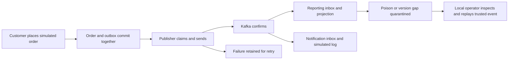

# CommerceHub BE-02 scenarios

## Checkout and outbox

| ID | Scenario (given / when / then) | Priority | Tested by |
| --- | --- | --- | --- |
| CMP-01 | Given the existing demo, when checkout repeats or stock is insufficient, then totals, ownership and stock behavior remain intact. | P1 | API/domain existing suites |
| OUT-01 | Given events enabled, when an order commits, then one safe outbox event commits; duplicate checkout creates no new event. | P1 | H2/PostgreSQL integration |
| OUT-02 | Given failure after order/outbox writes, when transaction rolls back, then neither survives and stock is restored. | P1 | H2/PostgreSQL integration |
| OUT-03 | Given events disabled, when checkout succeeds, then no event/network dependency is introduced. | P1 | H2 integration |

## Publisher and recovery

| ID | Scenario (given / when / then) | Priority | Tested by |
| --- | --- | --- | --- |
| PUB-01 | Given a claimed event, when broker confirms, then published time is recorded; failures retain the row. | P1 | unit, Kafka/PostgreSQL integration |
| PUB-02 | Given competing publishers or an expired lease, when claiming/resuming, then ownership is exclusive and stale confirmation cannot overwrite a newer claim. | P1 | engine integration |
| PUB-03 | Given repeated failures, when retrying, then delays cap and ten attempts stop automatic retries; operator can restart them. | P1 | engine/domain |
| REC-01 | Given broker unavailable, when orders commit then broker recovers, then backlog drains without missing effects. | P1 | real Kafka/PostgreSQL process harness |
| REC-02 | Given a crash after database commit or send, when restarting, then durable outbox/inbox recover safely. | P1 | real process harness |

## Consumers and poison

| ID | Scenario (given / when / then) | Priority | Tested by |
| --- | --- | --- | --- |
| CON-01 | Given duplicate Kafka records, when both groups process, then each effect happens once and offsets follow the database commit. | P1 | real Kafka/engine integration |
| CON-02 | Given an effect write failure, when processing rolls back, then no inbox survives and redelivery can succeed. | P1 | engine integration |
| ORD-01 | Given stale/gapped versions, when consumed, then reporting never regresses and ordering failures are visible. | P1 | engine integration |
| POI-01 | Given malformed, oversized, unknown-field/schema or mismatched-key records, when consumed, then quarantine records only safe metadata. | P1 | engine/domain |
| POI-02 | Given quarantine, when authorized retry uses a stable request key, then only trusted stored payload is replayed and repeats have no second effect. | P1 | API/engine |

## Operator, observability and security

| ID | Scenario (given / when / then) | Priority | Tested by |
| --- | --- | --- | --- |
| ADM-01 | Given anonymous, Customer, merchant or non-loopback callers, when inspecting/retrying, then access is denied; local Support may inspect. | P1 | API |
| ADM-02 | Given invalid page/state/id/origin/key or replay flood, when calling admin, then safe 4xx and no mutation result. | P1 | API |
| ADM-03 | Given a foreign Origin, when a local admin request is rejected before the controller, then it still returns the safe JSON error contract. | P2 | API, live HTTP |
| OBS-01 | Given unconfirmed delivery, unavailable broker, missing samples or backlog, when reading health, then freshness/lag never imply healthy delivery. | P1 | API/engine |
| SEC-01 | Given order events/admin errors, when serialized/logged, then no credentials, customer data, raw payload or exception detail leaks. | P1 | API/domain and secret scan |

## QA pass

The test catalogue has 19 automated scenarios. No browser page is added by BE-02; existing storefront
remains unchanged. HTTP checks operate the actual compiled lab, real Kafka 3.9.1 and PostgreSQL 17.11;
they do not intercept responses. `scripts/probe-event-lab.mjs` passed 30 external HTTP checks on November 18.
Process recovery scenarios run actual child-process kills/restarts and verify database invariants.

| Defect | Severity | Steps / expected / actual | Fix / regression |
| --- | --- | --- | --- |
| Operator Origin rejection violated JSON contract | P2 | POST replay with foreign Origin; expected safe JSON 403; actual Spring CORS text caused the API client JSON parser to fail | ADM-03 failed first (`target/be02-red-origin.log`); new scoped Origin filter returns a bounded safe envelope and audit; rebuilt lab's 30 HTTP probes pass |
| Broker-readiness harness could not construct Admin client | Harness | Kafka started, but default API timeout was below request timeout; readiness failed | Explicit compatible timeouts; retained initial failed runs, then real restart tests passed; this is not an app data-loss defect |

Checked correct live: Customer/merchant/anonymous denial, catalog, quote authority preserved by existing
suites, actual purchase/checkout replay/owned receipt, bad query bounds, foreign/missing Origin, forged bearer,
Support metadata/health, audited replay and duplicate replay. The broader real-process test also injects
unknown-schema poison, observes both quarantine records and resolves them by replaying trusted original data.

Five targeted guard mutations are caught (atomic writer, consumer inbox, version check, confirmation,
operator role); sources are restored byte-for-byte. The initial confirmation mutant failed compilation,
so it was corrected to compile and the intended test failure was observed. No compilation failure is
counted as a successful behavioral mutation check.

Final corrected full run: **82 tests passed**, 19 scenario rows covered, 0 skips, 12 seeded crash cycles
under four CPU workers; 82 committed orders/effects consistent, stock invariant true, final lag/backlog
and unresolved quarantine zero. The full run took 518,232ms. This is a bounded local fault soak.

Still outside completed proof: prolonged soak beyond the documented bounded cycles, verified idle-machine
comparative tuning, hosted CI/service-container execution, public deployment, human teach-back/demo.
Dependency findings remain release-blocking; see architecture and quality-status. No frontend/browser
pass or real Supabase recovery is implied by this backend-only QA.

## Human checks

Narrated 60–120 second demo and developer teach-backs: PENDING. No human mastery is inferred from tests.
